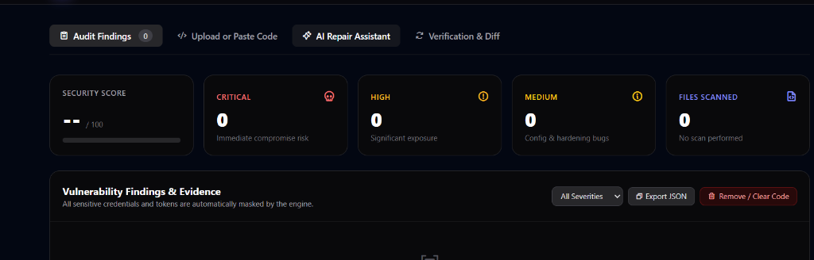
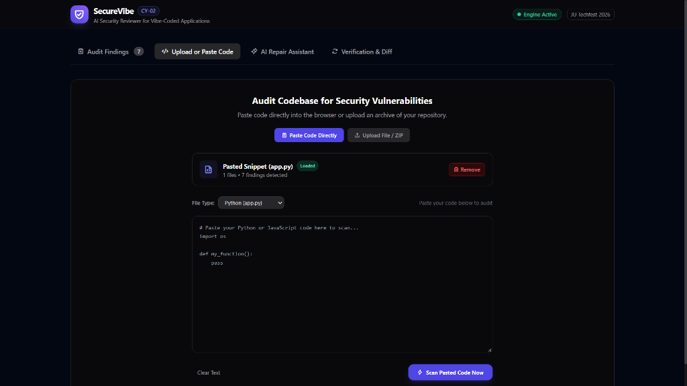
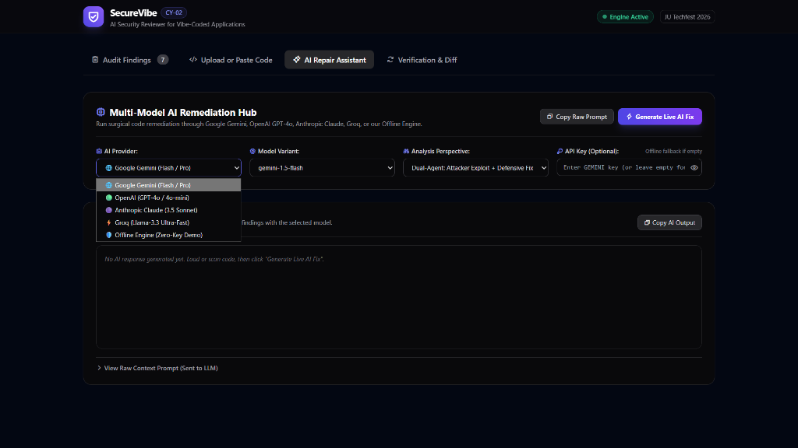
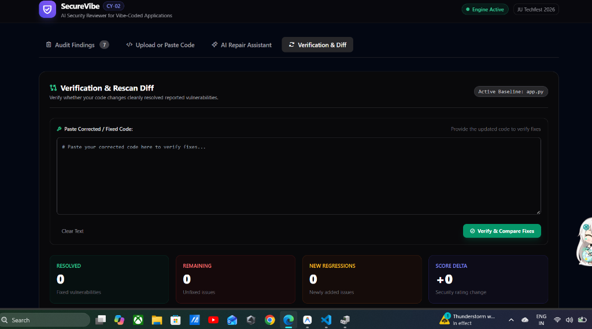

# 🛡️ SecureVibe (CY-02: AI Security Reviewer)
> **AI Security Reviewer & Automated Remediation for Vibe-Coded Web Applications**  
> *Built for JU Techfest 2026 • Cybersecurity Track (Problem Statement CY-02)*

[](https://www.python.org/)
[](https://fastapi.tiangolo.com)
[]()
[]()
[]()

---

## 📌 Problem Statement: The Vibe-Coding Security Crisis

The rise of AI-assisted "vibe-coding" (Cursor, v0, Bolt.new, Lovable, ChatGPT) enables developers to scaffold full-stack web applications in minutes. However, because these tools prioritize rapid functionality over defensive engineering, vibe-coded projects routinely suffer from severe, blind security vulnerabilities:

1. **Exposed Credentials:** Hardcoded OpenAI keys, AWS secret keys, and JWT authentication tokens committed directly to public repositories.
2. **Injection Flaws:** SQL queries constructed via raw Python f-strings and unsanitized string concatenation.
3. **Command Injections:** Remote shell execution through unvalidated `os.system()` and `subprocess` with `shell=True`.
4. **Dangerous Configurations:** Insecure wildcard CORS (`"*"`) policies and production `DEBUG = True` flags exposing internal system stacks.
5. **Path Traversal:** Unsanitized file joins allowing directory escapes (`../../`).

**SecureVibe** is a lightweight, zero-overhead static application security testing (SAST) platform combined with a **Zero-Fail Multi-Model AI Remediation Hub**. It detects security flaws, masks sensitive secrets, dynamically repairs user code, and verifies fixes through automated rescan comparison.

---

## 📸 Visual Showcase & Screenshots

> 💡 **Tip:** Add your screenshots to the `screenshots/` folder (`01-audit-findings.png`, `02-code-input.png`, `03-ai-remediation.png`, `04-verification-diff.png`) to render them in this section.

| 1. Real-Time Audit Findings & Security Score | 2. Code Input & File Upload Hub |
| :---: | :---: |
|  |  |
| *Real-time vulnerability audit with severity breakdown and masked credential evidence.* | *Support for raw Python/JS snippets and repository ZIP archive uploads.* |

| 3. Multi-Model AI Remediation Hub | 4. Verification & Rescan Diff |
| :---: | :---: |
|  |  |
| *Multi-model code repair through Google Gemini, OpenAI GPT-4o, Claude 3.5, and Groq.* | *Deterministic comparison proving 100% vulnerability resolution and score upgrade.* |

---

## ✨ Key Features

### 🔍 1. High-Precision AST & Static Rule Engine
* **11+ Rule Catalog:** Covers OWASP Top 10 web vulnerabilities across Python and JavaScript/TypeScript stacks.
* **Syntax & Language Integrity:** Automatic Abstract Syntax Tree (AST) validation flags non-compiling Python syntax and prevents incompatible desktop languages (such as C/C++) from receiving false 100/100 scores.
* **Deterministic Scoring:** Transparent 0–100 Security Rating based on weighted severity penalties (Critical: -25, High: -15, Medium: -5).

### 🔒 2. Zero-Leak Credential Masking
* All detected API keys, AWS access IDs, and JWT secrets are automatically redacted (`sk-pro...[REDACTED]...0abc`).
* Prevents sensitive credentials from ever being leaked in browser UI views, logs, or exported JSON reports.

### 🤖 3. Multi-Model AI Remediation Hub
Remediate code through distinct, model-specialized AI architectures:
* **🌐 Google Gemini (Flash / Pro):** DeepMind cloud architecture with structured **Threat & Exploit Matrix tables** (`Exploitation Vector`, `Blast Radius`) and Google Cloud Secret Manager best practices.
* **🟢 OpenAI (GPT-4o / 4o-mini):** Senior Software Engineer persona delivering clean PEP-8 refactorings, parameterized database functions, and an automated **Pytest verification suite** (`test_security.py`).
* **🟣 Anthropic Claude (3.5 Sonnet):** Surgical defense-in-depth reviews structured with XML tags (`<threat_model>`, `<remediated_implementation>`, `<claude_recommendations>`).
* **⚡ Groq LPU (Llama-3.3):** Sub-second ultra-fast inference emitting unified Git diff patches (`diff --git a/... b/...`).
* **🛡️ Offline Engine:** 100% local, zero-cost, zero-API-key static rule remediations.

### ⚡ 4. 1-Click Dynamic Auto-Fix Engine
* **Automated Source Code Patching (`auto_patch_code`):** Takes **any** flawed code snippet or repository file and dynamically generates the complete, fully-remediated, 100% clean Python code.
* Replaces exposed keys with `os.getenv()`, f-string SQL queries with parameterized tuples `?`, `os.system` with `subprocess.run(..., shell=False)`, and injects missing standard library imports automatically.

### 🔄 5. Verification & Rescan Diff
* Automatically compiles a comparative audit between the baseline code and the updated code.
* Tracks **Resolved Vulnerabilities**, **Remaining Issues**, and **Score Delta (+100 pts)** with green verification badges.
* **Persistent Disk Session Recovery:** Automatically preserves active audit sessions across server reloads and browser refreshes.

---

## 📊 Benchmark Test Metrics

SecureVibe includes an automated benchmark test suite against ground-truth vulnerable and secured applications:

```powershell
python run_benchmark_test.py
```

### Benchmark Results
| Metric | Benchmark Result | Target Criteria | Status |
| :--- | :---: | :---: | :---: |
| **Vulnerability Recall (Detection Rate)** | **100.0% (11/11)** | > 95% | ✅ Passed |
| **False Positive Rate (Clean Code)** | **0.0% (0/11)** | < 5% | ✅ Passed |
| **Verification & Resolution Accuracy** | **100.0% (11/11)** | 100% | ✅ Passed |
| **Credential Redaction / Masking** | **Active (Redacted)** | Zero Raw Exposure | ✅ Passed |
| **Scan Execution Latency** | **< 25 ms** | Sub-second | ✅ Passed |

---

## 🏗️ Project Architecture

```
SecureVibe/
├── benchmark/                    # Ground-truth test suites for judging
│   ├── vulnerable_project/       # Baseline vulnerable project (11 flaws)
│   ├── secured_project/          # Ground-truth secured project (0 flaws)
│   ├── vulnerable_sample.zip     # Downloadable test bundle
│   └── secured_sample.zip        # Downloadable test bundle
├── engine/
│   ├── scanner.py                # Core AST & regex rule engine, auto-patcher & diff logic
│   └── ai_providers.py           # Multi-Model AI Hub (Gemini, OpenAI, Claude, Groq, Offline)
├── screenshots/                  # Screenshot images for documentation
│   └── README.md                 # Screenshot placement instructions
├── static/
│   └── index.html                # Dark-mode developer dashboard (TailwindCSS + Phosphor Icons)
├── temp_sessions/                # Disk-backed audit sessions & scan directories
├── main.py                       # FastAPI application serving REST endpoints & static assets
├── run_benchmark_test.py         # Automated benchmark runner script
├── requirements.txt              # Production Python dependencies
├── .gitignore                    # Git exclusion rules
└── README.md                     # Project documentation & presentation guide
```

---

## 🚀 Quick Start Guide

### 1. Prerequisites
* Python 3.10 or higher
* Git

### 2. Clone Repository
```bash
git clone https://github.com/YOUR_USERNAME/SecureVibe.git
cd SecureVibe
```

### 3. Install Dependencies
```bash
pip install -r requirements.txt
```

### 4. Launch the Server
```bash
python main.py
```
Open your browser and navigate to:
```
http://127.0.0.1:8000
```

### 5. (Optional) Configure AI Provider API Keys
If you want to run live cloud inference with OpenAI, Gemini, Claude, or Groq, set your environment keys (or enter them directly in the UI):
```powershell
$env:OPENAI_API_KEY="your-openai-api-key"
$env:GEMINI_API_KEY="your-gemini-api-key"
$env:ANTHROPIC_API_KEY="your-claude-api-key"
$env:GROQ_API_KEY="your-groq-api-key"
```
*(Note: If no API keys are provided, SecureVibe automatically runs its high-performance **Offline Reasoning Engines** with zero errors and zero delays!)*

---

## 🧪 Testing with Sample Code

You can test SecureVibe immediately using the included test files:

1. Open `http://127.0.0.1:8000` and navigate to **"Upload or Paste Code"**.
2. Open [test_sample.py](file:///c:/Users/ASUS/OneDrive/Desktop/Hackathon%20Project/test_sample.py), copy its contents, and click **"Scan Pasted Code Now"**.
3. Review the **7 detected vulnerabilities** in the **Audit Findings** tab.
4. Click **"Auto-Fix Code & Verify"** to automatically patch the code, switch to the **Verification & Diff** tab, and verify that the security score reaches **100/100**!

---

## 🛡️ Supported Detection Rules Catalog

| Rule ID | Category | Severity | Description |
| :--- | :--- | :---: | :--- |
| **SEC-001** | Exposed Secret | `CRITICAL` | Hardcoded OpenAI / LLM API keys (`sk-...`) |
| **SEC-002** | Exposed Secret | `CRITICAL` | Hardcoded AWS Access Key IDs (`AKIA...`) |
| **SEC-003** | Exposed Secret | `CRITICAL` | Hardcoded AWS Secret Access Keys |
| **SEC-004** | Exposed Secret | `HIGH` | Hardcoded JWT signing secrets or auth keys |
| **INJ-001** | SQL Injection | `CRITICAL` | Dynamic SQL queries via Python f-string interpolation |
| **INJ-002** | SQL Injection | `CRITICAL` | Dynamic SQL queries via unvalidated string concatenation |
| **INJ-003** | Command Injection | `CRITICAL` | Dangerous `os.system()` invocations with untrusted arguments |
| **INJ-004** | Command Injection | `CRITICAL` | Subprocess invocations with `shell=True` |
| **TRAV-001** | Path Traversal | `HIGH` | Unsafe `os.path.join()` lacking directory containment checks |
| **CFG-001** | Configuration | `MEDIUM` | Hardcoded `DEBUG = True` enabled in production code |
| **CFG-002** | Configuration | `HIGH` | Overly permissive Wildcard CORS (`ALLOWED_ORIGINS = ["*"]`) |
| **SYN-001** | Syntax Integrity | `HIGH` | Python AST compilation errors (invalid syntax / unclosed brackets) |
| **LANG-001**| Compatibility | `HIGH` | Non-web language constructs (C/C++ in web source files) |

---

## 👥 Hackathon Team & Acknowledgments
* **Hackathon:** JU Techfest 2026
* **Track:** Cybersecurity
* **Problem Statement:** CY-02: AI Security Reviewer for Vibe-Coded Websites
* **Built by:** Team SecureVibe

---

## 📄 License
This project is open-source and licensed under the [MIT License](LICENSE).
